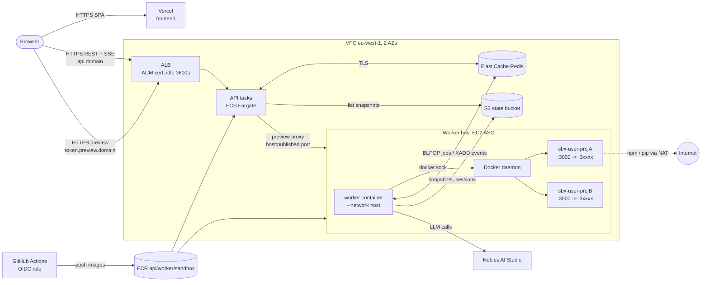

# Orqen architecture (production)

Orqen turns a chat prompt into a running app: an AI agent plans the app, writes the code inside a
private Docker sandbox, tests it in a headless browser, and serves a live preview.

## Components

| Component | Where it runs (AWS) | What it does |
|---|---|---|
| Frontend (`frontend/`) | Vercel (static SPA) | Vite + React canvas editor. Talks to the API only (`VITE_API_URL`). |
| API (`backend/app/api.py`) | ECS Fargate, 2+ tasks behind the ALB | `POST /runs` queues a job, `GET /runs/{id}/events` streams events (SSE), `GET /projects`, `POST /preview`, `/health` `/live` `/ready`. Also the **preview proxy** for `<token>.preview.<domain>`. Never calls the LLM, never needs Docker. |
| Worker (`backend/app/worker.py`) | EC2 Auto Scaling group (Amazon Linux 2023 + Docker) | Pops jobs from Redis, runs the Strands agent (planner / builder), drives one sandbox container per project through the host Docker daemon, runs the headless-Chromium UI check, snapshots projects to S3. |
| Sandboxes (`backend/sandbox_image`) | Containers on the worker host, Docker network `orqen-sbx` | One per project (`sbx-<user>-<project>`) with a named volume for `/workspace`. The generated app listens on :3000, published on a random host port. |
| Redis | ElastiCache (TLS + AUTH) | Job queue (`jobs` list), per-run event streams (`run:<id>`), project locks, preview tokens, sandbox addresses, worker heartbeats. |
| S3 state bucket | S3 (versioned, encrypted) | `snapshots/<sandbox>.tar.gz` (project source), `snapshots/archive/…` (pre-replan copies), `sessions/…` (agent chat history). |
| LLM | Nebius AI Studio (OpenAI-compatible) | Called by the worker only (`NEBIUS_API_KEY`, `BASE_URL`, `MODEL_ID`). |

**Why the worker is on EC2, not Fargate:** it needs a real Docker daemon to create sandbox
containers, volumes and published ports. Fargate has no Docker socket and no privileged mode.

**Why the API is on Fargate, not on the worker host:** it is stateless (Redis + S3), so it scales
and deploys independently, survives worker host replacement, and keeps the public entry point away
from the machine that runs untrusted code. Previews still work because the worker records each
sandbox's `host:port` in Redis and the API proxies to it over the VPC.

## Diagram

## Request flow

1. **Start a run.** The browser calls `POST https://api.<domain>/runs` with
   `Authorization: Bearer <JWT>` (or `X-User-Id` in dev). The API verifies the token, takes the
   project lock `lock:<user>-<project>` (409 if a run is active), records the run, and `RPUSH`es
   the job onto `jobs`. It returns `run_id` immediately.
2. **Stream events.** The browser opens `EventSource(…/runs/<id>/events?access_token=…)`. The API
   `XREAD`s the Redis stream `run:<id>` and forwards entries as SSE, with a keepalive every 15 s. A
   reconnect sends `Last-Event-ID` and replays from there. The ALB idle timeout (3600 s) is far above
   the keepalive interval, so streams stay open through the balancer.
3. **Run the agent.** A worker with a free slot `BLPOP`s the job, creates or starts the project
   sandbox (restoring the workspace from the local or S3 snapshot when the volume is new), records
   the sandbox's preview address `sandbox:<id>:addr = <private-ip>:<host-port>`, and runs the
   planner or builder. Every tool call acts inside the sandbox through `docker exec`. Text and tool
   events are `XADD`ed to `run:<id>`. Snapshots are written every `SNAPSHOT_EVERY` tool calls and at
   the end, then uploaded to S3.
4. **Check the UI.** `run_checks` loads each route of the generated app in headless Chromium on the
   worker host via the sandbox's published port.
5. **Finish.** The worker emits `done` (or `error`), snapshots, and releases the project lock.
6. **Preview.** `POST /preview` stores a random 16-hex token → sandbox mapping (24 h) and returns
   `https://<token>.preview.<domain>/`. The ALB sends `*.preview.<domain>` to the API, whose preview
   middleware looks up the token, then the sandbox address, and proxies the request to
   `<worker-private-ip>:<host-port>` (security group: worker ephemeral ports open to the API only).

## Shutdown and deploys

- **Worker SIGTERM** (deploy, scale-in, instance refresh): the worker stops taking jobs, lets running
  runs finish for `WORKER_SHUTDOWN_GRACE` seconds, then cancels them at a safe point
  (`Agent.cancel()`), snapshots them, and pushes them back to the front of the queue with the same
  `run_id` (lock kept, at most `MAX_JOB_ATTEMPTS` times). The browser keeps streaming the same run.
- **Scale-in / instance refresh** uses an ASG termination lifecycle hook; a timer on the host sees the
  `Terminated` target state, stops the worker gracefully, and completes the hook.
- **API deploys** are ECS rolling deploys with a circuit breaker and automatic rollback.

## Sandbox isolation (current)

- One container per project, memory/CPU/pid limits, `no-new-privileges`, dropped `NET_RAW`/`MKNOD`.
- Network `orqen-sbx`: internet allowed (package installs), **VPC and instance metadata blocked** by
  iptables `DOCKER-USER` rules, plus IMDSv2 with hop limit 1.
- Optional `SANDBOX_RUNTIME=runsc` (gVisor) or `sysbox-runc` for kernel-level isolation.
- Known gap: the worker container holds the host Docker socket (root-equivalent on the host). See
  `PRODUCTION-CHECKLIST.md`.

## Local / single-box modes

| Mode | How | Networking |
|---|---|---|
| Hark sandbox demo | `./start-stack.sh` (tunnels, unchanged) | `SANDBOX_NETWORK=host`, one preview at a time |
| Local dev | `uvicorn` + `python -m app.worker` (backend/README.md) | `bridge`, previews on published ports |
| Single host prod | `docker-compose.prod.yml` (Caddy + API + worker + Redis) | `bridge`, Caddy wildcard TLS |
| AWS | `infra/terraform` | as described above |
